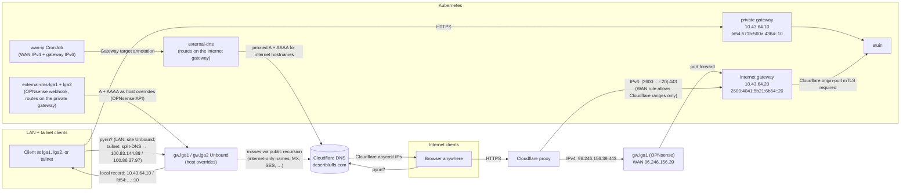

# Internet exposure

What each homelab service exposes, and where. Update this table when you add, remove, or move a
route between the `internet` and `private` gateways.

## Services

| Service | Namespace | Hostname | Internet | Notes |
| --- | --- | --- | --- | --- |
| Argo CD | `argocd` | `flopie` | Yes | HTTP and gRPC routes on the private gateway; HTTP only on the internet gateway. |
| authentik | `authentik` | `arsox` | Yes | |
| Atuin | `atuin` | `pyrin` | Yes | |
| Forgejo | `forgejo` | `dazzi`; SSH `dazzi.desertbluffs.com:22` | Yes | Git SSH runs only on the private gateway's TCP listener; Cloudflare can't proxy it. HTTPS pushes over the internet are subject to Cloudflare's request body limit (100 MB on Free and Pro). |
| Immich | `immich` | `nox` | Yes | |
| Jellyfin | `jellyfin` | `wixen` | Yes | |
| Obsidian LiveSync | `obsidian-livesync` | `lifmunk` | Yes | |
| PixivFE | `pixivfe` | `dupin` | Yes | Authentik protects every path on both gateways. |
| Plex | `pms` | `vixy`; LoadBalancer `10.43.64.2:32400` | Yes | |
| Shaarli | `shaarli` | `gumoss` | Yes | |
| Timekeeper (ash) | `timekeeper-ash` | `ash.kamotimestamps.com` | Only | No private route. |
| Timekeeper (oak) | `timekeeper-oak` | `oak.kamotimestamps.com` | Only | No private route. |
| Apex redirect | `envoy-gateway-system` | `desertbluffs.com`, `www` | Yes | Redirect only; no backend. The apex has no private route, so it resolves to the public addresses everywhere; `www` is private inside. |
| Engram | `engram` | `mau` | No | |
| Goldpinger | `goldpinger` | `fuack` | No | |
| Homepage | `homepage` | `bushi` | No | |
| httpbin | `httpbin` | `swee` | No | |
| Palworld | `palworld` | Live map `rooby`; game UDP `10.43.64.10:8211` | No | |
| Palworld (modded) | `palworld-modded` | Game UDP `10.43.64.10:8311` | No | |
| Radarr | `radarr` | `dumud` | No | |
| Seafile | `seafile` | `dogen` | No | |
| Sonarr | `sonarr` | `jolthog` | No | |

Hostnames are under `desertbluffs.com` unless written in full. Each app has exactly one hostname,
a codename picked from [CODENAMES.md](CODENAMES.md). An app reachable from the internet routes the
same hostname on both gateways; private DNS and public DNS answer it differently. The zone apex
is the exception: it has no private route and always resolves publicly.

Unmatched hostnames under `*.desertbluffs.com` (both gateways) get a catch-all `418` route (`kubernetes/apps-helm/envoy-gateway/manifests/unmatched-teapot.yaml`).

## Split-horizon DNS

One hostname per app, answered differently inside and outside. LAN and tailnet clients get the
private gateway; internet clients get Cloudflare. Using `pyrin.desertbluffs.com` (Atuin) as the
example.

- **Inside (`desertbluffs.com`):** Each site gateway's Unbound answers every hostname routed on
  the private gateway with that gateway's addresses, including names that also have public
  records, so traffic stays on the private network. Two `external-dns` releases
  (`external-dns-lga1` and `external-dns-lga2`) publish those routes as Unbound host overrides
  through the OPNsense API, one per gateway. Tailnet clients use split-DNS
  (`tailnet/tofu/dns.tf`) pointing `desertbluffs.com` to both gateways (`100.83.144.88`,
  `100.86.37.97`). Names without a host override fall through to public recursion.
- **Site infrastructure (`*.lga1.radoncanyon.com`, `*.lga2.radoncanyon.com`):** Gateways, nodes,
  NAS, and odroids live as Unbound host overrides (LAN A + ULA AAAA) on both `gw.lga1` and
  `gw.lga2` (`gateway/`), so they resolve even when the cluster is down. Tailnet split-DNS routes
  `radoncanyon.com` to both gateways (`100.83.144.88`, `100.86.37.97`), and Tailscale MagicDNS (`*.macaroni-pirate.ts.net`) answers tailnet IPs
  automatically. No private IPs are published in Cloudflare (`dns/`).
- **Outside:** Cloudflare answers with its own anycast addresses, because every internet record is
  proxied. The A and AAAA contents (the WAN address and the gateway's public IPv6 address) are only
  where Cloudflare connects, and never appear in public answers.
- A hostname routed only on the internet gateway has no host override, so LAN and tailnet
  clients fall through to Cloudflare and follow the same path as internet clients.
- Apps that use SSO (OIDC or SAML) see one hostname everywhere, so redirect URIs, issuers, and
  session cookies match whether the browser is inside or outside.

## Paths

### Internet

1. Cloudflare serves the public DNS record, proxied (`external-dns.kubernetes.io/cloudflare-proxied: "true"`).
   The `external-dns` instance only publishes routes attached to the `internet` gateway.
2. Each internet hostname has its own proxied A and AAAA record. Their content is where Cloudflare
   connects: the WAN address and the `internet` gateway's public IPv6 address. The `wan-ip`
   CronJob (`apps/wan-ip`) detects the WAN address every 5 minutes and writes both addresses to
   the gateway's `external-dns.kubernetes.io/target` annotation, which the `external-dns` instance
   applies to every route. The apex `desertbluffs.com` is a proxied CNAME to `www` in
   `dns/desertbluffs.com.tf`, because external-dns can't own apex records.
3. The router sends that traffic to the `internet` gateway at `10.43.64.20`.
4. The gateway accepts only TLS clients that present a Cloudflare authenticated origin pull
   certificate (`tls-settings-internet` in `tls-settings-policy.yaml`), so connections that
   bypass Cloudflare fail the TLS handshake.

The `internet` gateway also has the public IPv6 address `2600:4041:5b21:6b64::20`, from the
Cilium `public-v6` pool (`2600:4041:5b21:6b64::/112`, in `apps-helm/cilium/manifests/bgp.yaml`).
Only Services labeled `lbipam.homelab/pool: public` get addresses from that pool, and the gateway
is the only one. OPNsense's WAN rule `ingress gateway` allows port 443 to it (alias
`ingress_gateway_v6`) only from Cloudflare's published ranges (`cf_ips_v6`). The address sits
inside the prefix Verizon delegates, so it changes if that prefix does; the pool, the alias, and
the gateway's `lbipam.cilium.io/ips` annotation then need the new prefix, and external-dns follows.
With both records published, Cloudflare still reaches the origin over IPv4.

### Private

- The `private` gateway at `10.43.64.10` and `fd54:571b:560a:4364::10` is advertised to the LAN
  router (`192.168.222.1`) over BGP from Cilium.
- `external-dns-lga1` and `external-dns-lga2` publish the private gateway's routes as Unbound
  host overrides (A + AAAA) on the two OPNsense gateways, one release per site, through the
  `crutonjohn/external-dns-opnsense-webhook` provider.
- Pods have global IPv6 addresses from `2600:4041:5b21:6b10::/64`, taken from the delegated
  `2600:4041:5b21:6b00::/56`. Cilium advertises the pod CIDRs to the LAN router over BGP and IPv6
  masquerade is off, so pods egress as themselves. Unsolicited inbound is still blocked at the WAN.
- The Tailscale operator exposes the private gateway on the tailnet through the `heimdall` proxy
  group.

## Not tracked here

- Router port forwards other than the one implied by the internet path, for example whether Plex's
  `32400` is forwarded from the WAN.
- Tailscale Funnel. `tailnet/policy.hujson` grants the `funnel` attribute to `autogroup:member`
  and `tag:admin`, but no Funnel configuration lives in this repo.
