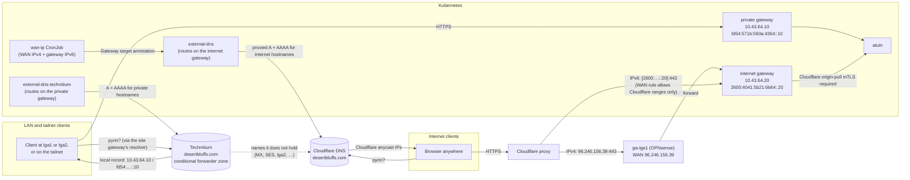

# Internet exposure

What each homelab service exposes, and where. Update this table when you add, remove, or move a
route between the `internet` and `private` gateways.

## Services

| Service | Namespace | Internet | Private (LAN + tailnet) | Notes |
| --- | --- | --- | --- | --- |
| Argo CD | `argocd` | `flopie.desertbluffs.com` | `argocd`, `flopie` | HTTP and gRPC routes on the private gateway; HTTP only on the internet gateway. |
| Atuin | `atuin` | `pyrin.desertbluffs.com` | `atuin`, `pyrin` | |
| Forgejo | `forgejo` | `dazzi.desertbluffs.com` | `git`, `dazzi`; SSH `git.desertbluffs.com:22` | Git SSH runs only on the private gateway's TCP listener; Cloudflare can't proxy it. HTTPS pushes over the internet are subject to Cloudflare's request body limit (100 MB on Free and Pro). |
| Immich | `immich` | `nox.desertbluffs.com` | `immich`, `nox` | |
| Jellyfin | `jellyfin` | `wixen.desertbluffs.com` | `jellyfin`, `wixen` | |
| Obsidian LiveSync | `obsidian-livesync` | `lifmunk.desertbluffs.com` | `livesync`, `lifmunk` | |
| Plex | `pms` | `vixy.desertbluffs.com` | `plex`, `vixy`; LoadBalancer `10.43.64.2:32400` | |
| Shaarli | `shaarli` | `gumoss.desertbluffs.com` | `shaarli`, `gumoss` | |
| Timekeeper (ash) | `timekeeper-ash` | `ash.kamotimestamps.com` | — | Internet only. |
| Timekeeper (oak) | `timekeeper-oak` | `oak.kamotimestamps.com` | — | Internet only. |
| Apex redirect | `envoy-gateway-system` | `desertbluffs.com`, `www` | `desertbluffs.com`, `www` | Redirect only; no backend. |
| Engram | `engram` | — | `engram`, `mau` | |
| Goldpinger | `goldpinger` | — | `goldpinger`, `fuack` | |
| Homepage | `homepage` | — | `home` | |
| httpbin | `httpbin` | — | `httpbin`, `swee` | |
| Palworld | `palworld` | — | Live map `palmap`, `rooby`; game UDP `10.43.64.10:8211` | |
| Palworld (modded) | `palworld-modded` | — | Game UDP `10.43.64.10:8311` | |
| Radarr | `radarr` | — | `radarr`, `dumud` | |
| Seafile | `seafile` | — | `seafile` | |
| Sonarr | `sonarr` | — | `sonarr`, `jolthog` | |
| Technitium | `technitium` | — | Web `dns`; DNS `10.43.64.53`, `fd54:571b:560a:4364::53`; tailnet `technitium` | |

Hostnames in the Private column are under `desertbluffs.com` unless written in full. A public
service's codename (pick new ones from [CODENAMES.md](CODENAMES.md)) is also on its private
route, so the same URL resolves to the private gateway from the LAN and the tailnet.

Unmatched hostnames under `*.desertbluffs.com` (both gateways) get a catch-all `418` route (`kubernetes/apps-helm/envoy-gateway/manifests/unmatched-teapot.yaml`).

## Split-horizon DNS

The same name resolves differently depending on where the client asks. Using the codename
`pyrin.desertbluffs.com` as an example:

- **Inside:** Technitium answers from its own records, so a codename goes straight to the private
  gateway and never leaves the network. Each site's gateway (OPNsense Unbound) forwards
  `desertbluffs.com` and `nulogorsk.com` to Technitium (`10.43.64.53`) and nothing else; there
  are no zone copies on the gateways. Names Technitium doesn't hold are forwarded to public DNS.
- **Site infrastructure** (`*.lga1.radoncanyon.com`, `*.lga2.radoncanyon.com`: gateways, nodes,
  NAS, odroids) is not in the cluster. Both gateways answer the same list of names from Unbound
  host overrides, so infrastructure names resolve at either site even when the cluster is down.
  Update both gateways when that list changes. Other `radoncanyon.com` names resolve publicly.
- **Outside:** Cloudflare answers with its own anycast addresses, because every internet record is
  proxied. The A and AAAA contents (the WAN address and the gateway's public IPv6 address) are only
  where Cloudflare connects, and never appear in public answers.
- Only names on both gateways (the codenames) resolve both ways. Friendly names such as
  `atuin.desertbluffs.com` exist only inside.

## Paths

### Internet

1. Cloudflare serves the public DNS record, proxied (`external-dns.kubernetes.io/cloudflare-proxied: "true"`).
   The `external-dns` instance only publishes routes attached to the `internet` gateway.
2. Each internet hostname has its own proxied A and AAAA record. Their content is where Cloudflare
   connects: the WAN address and the `internet` gateway's public IPv6 address. The `wan-ip`
   CronJob (`apps/wan-ip`) detects the WAN address every 5 minutes and writes both addresses to
   the gateway's `external-dns.kubernetes.io/target` annotation, which the `external-dns` instance
   applies to every route. The apex `desertbluffs.com` is a proxied CNAME to `www` in
   `dns/desertbluffs.com.tf`, because external-dns can't own apex records.
3. The router sends that traffic to the `internet` gateway at `10.43.64.20`.
4. The gateway accepts only TLS clients that present a Cloudflare authenticated origin pull
   certificate (`tls-settings-internet` in `tls-settings-policy.yaml`), so connections that
   bypass Cloudflare fail the TLS handshake.

The `internet` gateway also has the public IPv6 address `2600:4041:5b21:6b64::20`, from the
Cilium `public-v6` pool (`2600:4041:5b21:6b64::/112`, in `apps-helm/cilium/manifests/bgp.yaml`).
Only Services labeled `lbipam.homelab/pool: public` get addresses from that pool, and the gateway
is the only one. OPNsense's WAN rule `ingress gateway` allows port 443 to it (alias
`ingress_gateway_v6`) only from Cloudflare's published ranges (`cf_ips_v6`). The address sits
inside the prefix Verizon delegates, so it changes if that prefix does; the pool, the alias, and
the gateway's `lbipam.cilium.io/ips` annotation then need the new prefix, and external-dns follows.
With both records published, Cloudflare still reaches the origin over IPv4.

### Private

- The `private` gateway at `10.43.64.10` and `fd54:571b:560a:4364::10` is advertised to the LAN
  router (`192.168.222.1`) over BGP from Cilium.
- `external-dns-technitium` publishes its routes to Technitium for LAN DNS, as A and AAAA records.
- Technitium serves `desertbluffs.com` as a Conditional Forwarder zone: names it holds resolve to
  the private gateway, and every other name is forwarded to public DNS (mail records, `lga2`).
  Every name it holds needs both an A and an AAAA record; an AAAA query for a name with only an A
  record is forwarded and returns Cloudflare's public address. external-dns can't own the apex, so
  the apex AAAA is a static record in Technitium.
- Pods have global IPv6 addresses from `2600:4041:5b21:6b10::/64`, taken from the delegated
  `2600:4041:5b21:6b00::/56`. Cilium advertises the pod CIDRs to the LAN router over BGP and IPv6
  masquerade is off, so pods egress as themselves. Unsolicited inbound is still blocked at the WAN.
- The Tailscale operator exposes the private gateway and Technitium DNS on the tailnet through the
  `heimdall` proxy group.

## Not tracked here

- Router port forwards other than the one implied by the internet path, for example whether Plex's
  `32400` is forwarded from the WAN.
- Tailscale Funnel. `tailnet/policy.hujson` grants the `funnel` attribute to `autogroup:member`
  and `tag:admin`, but no Funnel configuration lives in this repo.
- Hosts outside the cluster, such as the Technitium proxy on `odroid.lga1.radoncanyon.com`.
