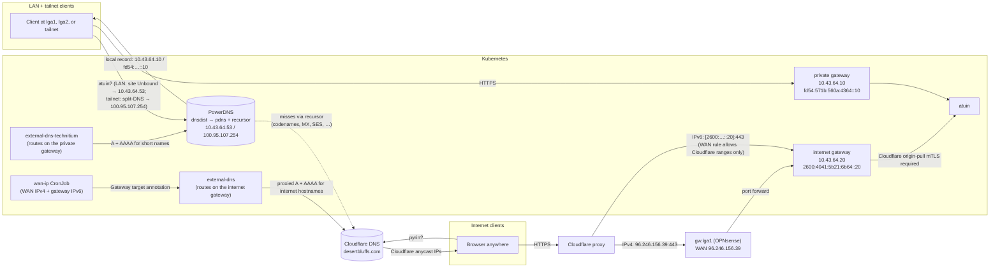

# Internet exposure

What each homelab service exposes, and where. Update this table when you add, remove, or move a
route between the `internet` and `private` gateways.

## Services

| Service | Namespace | Internet | Private (LAN + tailnet) | Notes |
| --- | --- | --- | --- | --- |
| Argo CD | `argocd` | `flopie.desertbluffs.com` | `argocd` | HTTP and gRPC routes on the private gateway; HTTP only on the internet gateway. |
| Atuin | `atuin` | `pyrin.desertbluffs.com` | `atuin` | |
| Forgejo | `forgejo` | `dazzi.desertbluffs.com` | `git`; SSH `git.desertbluffs.com:22` | Git SSH runs only on the private gateway's TCP listener; Cloudflare can't proxy it. HTTPS pushes over the internet are subject to Cloudflare's request body limit (100 MB on Free and Pro). |
| Immich | `immich` | `nox.desertbluffs.com` | `immich` | |
| Jellyfin | `jellyfin` | `wixen.desertbluffs.com` | `jellyfin` | |
| Obsidian LiveSync | `obsidian-livesync` | `lifmunk.desertbluffs.com` | `livesync` | |
| Plex | `pms` | `vixy.desertbluffs.com` | `plex`; LoadBalancer `10.43.64.2:32400` | |
| Shaarli | `shaarli` | `gumoss.desertbluffs.com` | `shaarli` | |
| Timekeeper (ash) | `timekeeper-ash` | `ash.kamotimestamps.com` | — | Internet only. |
| Timekeeper (oak) | `timekeeper-oak` | `oak.kamotimestamps.com` | — | Internet only. |
| Apex redirect | `envoy-gateway-system` | `desertbluffs.com`, `www` | `desertbluffs.com`, `www` | Redirect only; no backend. |
| Engram | `engram` | — | `engram`, `mau` | |
| Goldpinger | `goldpinger` | — | `goldpinger`, `fuack` | |
| Homepage | `homepage` | — | `home` | |
| httpbin | `httpbin` | — | `httpbin`, `swee` | |
| Palworld | `palworld` | — | Live map `palmap`, `rooby`; game UDP `10.43.64.10:8211` | |
| Palworld (modded) | `palworld-modded` | — | Game UDP `10.43.64.10:8311` | |
| Radarr | `radarr` | — | `radarr`, `dumud` | |
| Seafile | `seafile` | — | `seafile` | |
| Sonarr | `sonarr` | — | `sonarr`, `jolthog` | |
| PowerDNS (`dnsdist`) | `pdns` | — | DNS `10.43.64.53`, `fd54:571b:560a:4364::53`; tailnet `100.95.107.254` (`technitium`) | |

Hostnames in the Private column are under `desertbluffs.com` unless written in full. Private DNS
holds those short names only. Codenames (pick new ones from [CODENAMES.md](CODENAMES.md)) exist
only in public DNS, so they resolve to Cloudflare from the LAN and the tailnet too.

Unmatched hostnames under `*.desertbluffs.com` (both gateways) get a catch-all `418` route (`kubernetes/apps-helm/envoy-gateway/manifests/unmatched-teapot.yaml`).

## Split-horizon DNS

Short names resolve to the private gateway from both the LAN and the tailnet; codenames never
appear in private DNS, so they resolve via Cloudflare everywhere. Using `atuin.desertbluffs.com`
and its codename `pyrin.desertbluffs.com` as the examples.

- **Inside (`desertbluffs.com`):** Cluster PowerDNS (`dnsdist` → `pdns` authoritative + `recursor`,
  in namespace `pdns`) answers short names with the private gateway's addresses, so traffic stays
  on the private network. Both site gateways (OPNsense Unbound, managed in `gateway/`) forward
  `desertbluffs.com` directly to `10.43.64.53` (`gw.lga1` over BGP, `gw.lga2` via `odroid.lga2`).
  Tailnet clients use split-DNS (`tailnet/tofu/dns.tf`) pointing `desertbluffs.com` to
  `100.95.107.254`. Names not in `pdns` fall through to `recursor` and public DNS.
- **Site infrastructure (`*.lga1.radoncanyon.com`, `*.lga2.radoncanyon.com`):** Gateways, nodes,
  NAS, and odroids live as Unbound host overrides (LAN A + ULA AAAA) on both `gw.lga1` and
  `gw.lga2` (`gateway/`), so they resolve even when the cluster is down. Tailnet split-DNS routes
  `lga1.radoncanyon.com` and `lga2.radoncanyon.com` to both gateways (`100.83.144.88`,
  `100.86.37.97`), and Tailscale MagicDNS (`*.macaroni-pirate.ts.net`) answers tailnet IPs
  automatically. No private IPs are published in Cloudflare (`dns/`).
- **Outside:** Cloudflare answers with its own anycast addresses, because every internet record is
  proxied. The A and AAAA contents (the WAN address and the gateway's public IPv6 address) are only
  where Cloudflare connects, and never appear in public answers.
- A codename such as `pyrin.desertbluffs.com` is absent from `pdns`, so LAN and tailnet clients
  fall through to Cloudflare and follow the same path as internet clients.

## Paths

### Internet

1. Cloudflare serves the public DNS record, proxied (`external-dns.kubernetes.io/cloudflare-proxied: "true"`).
   The `external-dns` instance only publishes routes attached to the `internet` gateway.
2. Each internet hostname has its own proxied A and AAAA record. Their content is where Cloudflare
   connects: the WAN address and the `internet` gateway's public IPv6 address. The `wan-ip`
   CronJob (`apps/wan-ip`) detects the WAN address every 5 minutes and writes both addresses to
   the gateway's `external-dns.kubernetes.io/target` annotation, which the `external-dns` instance
   applies to every route. The apex `desertbluffs.com` is a proxied CNAME to `www` in
   `dns/desertbluffs.com.tf`, because external-dns can't own apex records.
3. The router sends that traffic to the `internet` gateway at `10.43.64.20`.
4. The gateway accepts only TLS clients that present a Cloudflare authenticated origin pull
   certificate (`tls-settings-internet` in `tls-settings-policy.yaml`), so connections that
   bypass Cloudflare fail the TLS handshake.

The `internet` gateway also has the public IPv6 address `2600:4041:5b21:6b64::20`, from the
Cilium `public-v6` pool (`2600:4041:5b21:6b64::/112`, in `apps-helm/cilium/manifests/bgp.yaml`).
Only Services labeled `lbipam.homelab/pool: public` get addresses from that pool, and the gateway
is the only one. OPNsense's WAN rule `ingress gateway` allows port 443 to it (alias
`ingress_gateway_v6`) only from Cloudflare's published ranges (`cf_ips_v6`). The address sits
inside the prefix Verizon delegates, so it changes if that prefix does; the pool, the alias, and
the gateway's `lbipam.cilium.io/ips` annotation then need the new prefix, and external-dns follows.
With both records published, Cloudflare still reaches the origin over IPv4.

### Private

- The `private` gateway at `10.43.64.10` and `fd54:571b:560a:4364::10` is advertised to the LAN
  router (`192.168.222.1`) over BGP from Cilium.
- `external-dns-technitium` publishes its routes to PowerDNS (`pdns`) for internal DNS, as A and
  AAAA records.
- `dnsdist` routes names present in `pdns` to the authoritative server and forwards every other
  query to `recursor` (with DNSSEC validation). `routes-sync` refreshes the routed-name list from
  the `pdns` API every 60 seconds. external-dns can't own the apex, so the `desertbluffs.com` apex
  A and AAAA records are static records in `pdns`.
- Pods have global IPv6 addresses from `2600:4041:5b21:6b10::/64`, taken from the delegated
  `2600:4041:5b21:6b00::/56`. Cilium advertises the pod CIDRs to the LAN router over BGP and IPv6
  masquerade is off, so pods egress as themselves. Unsolicited inbound is still blocked at the WAN.
- The Tailscale operator exposes the private gateway and `dnsdist` (`100.95.107.254`, hostname
  `technitium`) on the tailnet through the `heimdall` proxy group.

## Not tracked here

- Router port forwards other than the one implied by the internet path, for example whether Plex's
  `32400` is forwarded from the WAN.
- Tailscale Funnel. `tailnet/policy.hujson` grants the `funnel` attribute to `autogroup:member`
  and `tag:admin`, but no Funnel configuration lives in this repo.
